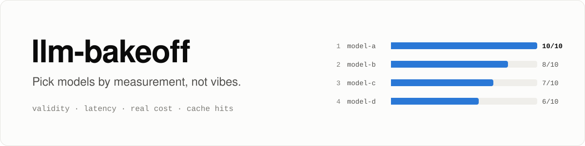
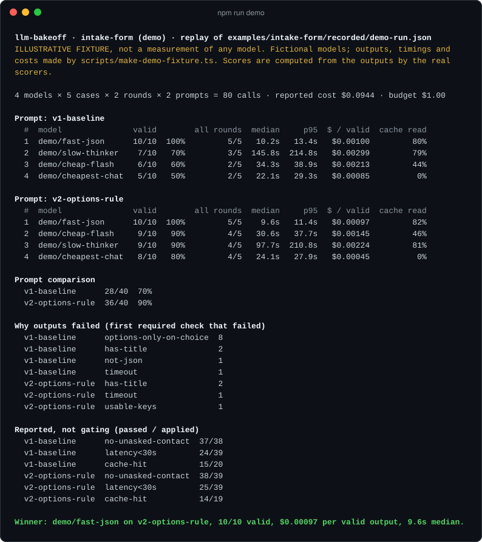
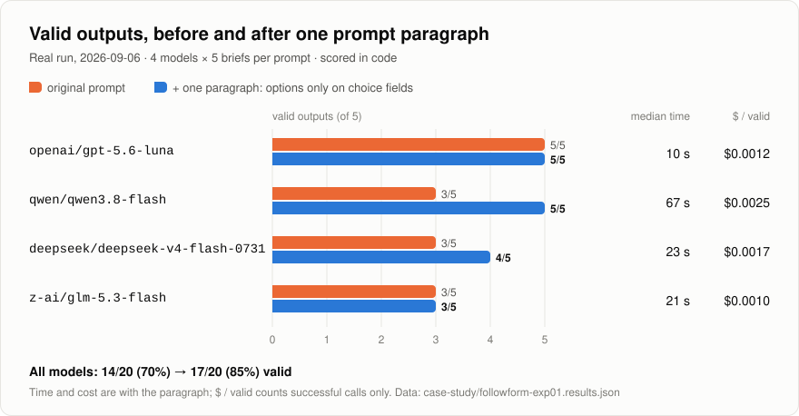
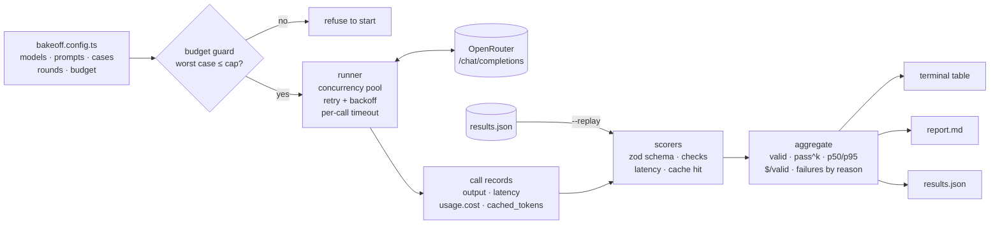

<p align="center">
  <picture>
    <source media="(prefers-color-scheme: dark)" srcset="assets/banner-dark.svg">
    
  </picture>
</p>

<p align="center">
  <a href="https://github.com/andrescr94/llm-bakeoff/actions/workflows/ci.yml"></a>
  <a href="LICENSE"></a>
  
  
</p>

**llm-bakeoff runs several LLMs on the same task, scores every output in code, and ranks them on validity, latency, real cost and prompt-cache hits.**

## Why this exists

Most teams pick a model the way they pick a restaurant: a leaderboard, a few hand-tried prompts, a feeling. That breaks down on cheap models, where the differences that matter are not on any leaderboard. Does it return valid JSON *every* time, or four times out of five? Does it take 10 seconds or 3 minutes? What does one *usable* output cost once the failures are paid for? Does prompt caching actually engage for this model on this prompt? Each of those is a number. This harness measures them on your own task, repeats every run so one lucky pass does not count as reliability, and refuses to spend more than you said it could.

## Try it in 10 seconds

No API key, no network. The demo replays a recorded results file through the real scorers and reporters:

```bash
git clone https://github.com/andrescr94/llm-bakeoff && cd llm-bakeoff
npm install
npm run demo
```

<p align="center">
  
</p>

> The demo data is an **illustrative fixture**: fictional `demo/...` models, with outputs, timings and costs produced by [`scripts/make-demo-fixture.ts`](scripts/make-demo-fixture.ts). It says so at the top of every report. The scores are not typed in; they are computed from the fixture's JSON outputs by the same scorers a live run uses. For real numbers, see the case study below or run `npm run case-study`.

## What it measures

| Measure | Where it comes from |
|---|---|
| **Valid output** | Every required scorer passes. Scorers are plain functions: a zod schema plus task-specific checks. |
| **All rounds** (pass^k) | Cases that were valid in *every* round. A model that passes each case once has not been shown to be reliable. |
| **Latency** | Wall time of each call; median and p95 per model. Timeouts count. |
| **Cost per valid output** | Sum of OpenRouter's reported `usage.cost` ÷ valid outputs. Never computed from a price table. |
| **Cache read** | `usage.prompt_tokens_details.cached_tokens` ÷ input tokens, as the API reported it. |
| **Why outputs failed** | The first required check each invalid output failed, counted per prompt variant. |

The ranking is: most valid first, then cheapest per valid output, then fastest median.

## Case study: one prompt paragraph removed a whole failure mode

This harness is the cleaned-up, generic version of an experiment I ran for [Followform](https://followform.tikos.studio), an AI forms product, on **2026-09-06**. The question: can a cheap model reliably turn a one-line request into a form definition? Four inexpensive models on OpenRouter, five requests each, every output checked by the product's own schema validator.

<p align="center">
  <picture>
    <source media="(prefers-color-scheme: dark)" srcset="assets/results-dark.svg">
    
  </picture>
</p>

**What happened.** On the first pass only 14 of 20 outputs were valid (70%). The most common failure, 3 of the 6, was the same one in three different models: they attached a list of suggested answers (`options`) to a free-text field. The validator rejects that, because only choice fields carry options, but the prompt never said so. The models were being helpful in a way the system could not accept. One paragraph added to the prompt stating the rule removed that failure entirely: **0 occurrences on the second pass, and 17 of 20 valid (85%)**. The three remaining failures were different, model-specific problems (an empty field key, two forms with no name), which is what the "why outputs failed" table is for.

**Who won.** `openai/gpt-5.6-luna` was the only model valid on all 10 runs across both prompts, at about **10 s median and $0.0012 per form**. `qwen/qwen3.8-flash` reached 5/5 with the fix but took 50 to 197 seconds per form, and timed out once at 240 s on the first pass. `z-ai/glm-5.3-flash` cost slightly less per call ($0.0011 per form against $0.0012) but was valid only 3 times in 5 on either prompt, so once failures are retried a usable form costs it about $0.0018, half again as much as the winner.

**Caching is model-specific.** The same system prompt (1,780 to 2,420 input tokens, depending on each model's tokenizer) was sent twice to each model, reading `cached_tokens` on the second call:

| model (OpenRouter id) | second call, cached / input tokens |
|---|---|
| `openai/gpt-5.6-luna` | 1,748 / 1,780, automatic |
| `z-ai/glm-5.3-flash` | 1,728 / 1,784, automatic |
| `qwen/qwen3.8-flash` | 1,792 / 1,867, automatic |
| `deepseek/deepseek-v4-flash-0731` | 0 back to back; 1,792 when sent again minutes later |
| `google/gemini-3.5-flash-lite` | 0 with or without a cache breakpoint at this prompt size |
| `anthropic/claude-sonnet-5` | 0 without `cache_control`; 2,390 / 2,420 with it, cutting that call's cost 4.8x |

**Cost of the whole experiment:** $0.14 against a $0.40 budget, including the caching probes and some follow-up tests not shown here. In the chart, $ / valid counts only calls that succeeded, because the run's log did not keep the cost of failed ones.

**What I took from it**

1. **Validity belongs in code, not in impressions.** A validator run on every output found a 30% failure rate on the first pass, and its single largest cause.
2. **Fix the prompt before you fire the model.** Half of the failures came from one missing sentence in the prompt, not from weak models. Counting failures by reason is what made that visible.
3. **Caching has to be measured per model.** Some cache automatically, one needs an explicit breakpoint, one writes its cache late, one cannot cache a prompt this size at all. An assumed discount is not a discount.
4. **Rank by cost per valid output.** The cheapest call is not the cheapest result once failures are paid for and retried.

The per-call status, latency and cost of that run are in [`case-study/followform-exp01.results.json`](case-study/followform-exp01.results.json); `npm run case-study` prints them through the same aggregator and reporter. The product's prompts, requests and outputs are private and are not in this repository; the example task below reproduces the same method and the same failure mode on a fresh, public task.

## How it works



Each box is one small module in `src/`. The runner never throws for a single bad call: a timeout or an HTTP error becomes a record, because a failure is a measurement too. Scorers are pure functions, so `--replay` can re-score recorded outputs offline after you change a check, without paying for the calls again.

## Run it live

```bash
cp .env.example .env            # then put your OpenRouter key in .env
npm run bakeoff -- --config examples/intake-form/bakeoff.config.ts --dry-run
npm run bakeoff -- --config examples/intake-form/bakeoff.config.ts
```

`--dry-run` calls no model. It reads current prices from OpenRouter's public `/models` endpoint and prints the plan and its worst case:

```text
Dry run: intake-form. No model is called.
4 models × 2 prompts × 5 cases × 2 rounds = 80 calls
  openai/gpt-5.6-luna                    20 calls  worst case $0.3016
  qwen/qwen3.8-flash                     20 calls  worst case $0.1230
  deepseek/deepseek-v4-flash-0731        20 calls  worst case $0.3076
  z-ai/glm-5.3-flash                     20 calls  worst case $0.1302
Worst case $0.8625 against a $1.00 budget.
Within budget: a live run would start.
```

The worst case assumes every call uses its full output cap, every call is retried, and no cache discount applies, so real spend is far lower. If the worst case is above `budgetUsd`, the run refuses to start; set the example's budget to the case study's $0.40 and it does. During a run, spend is summed from reported `usage.cost`, and once it reaches the budget no new call starts. Results land in `results/<timestamp>/` as `results.json` and `report.md`.

## Add your own task

A task is a list of prompt variants, a list of cases and a list of scorers. Write one file:

```ts
// examples/support-reply/bakeoff.config.ts
import { z } from 'zod';
import { defineConfig } from '../../src/config.ts';
import { check, latencyUnder, matchesSchema } from '../../src/scorers/index.ts';

const Reply = z.object({ category: z.enum(['billing', 'bug', 'other']), reply: z.string() });

export default defineConfig({
  name: 'support-reply',
  task: {
    id: 'support-reply',
    description: 'Classify a support email and draft a reply, as JSON.',
    variants: [{ id: 'v1', system: 'Return {"category": ..., "reply": ...} for the email. JSON only.' }],
    cases: [
      { id: 'refund', user: 'I was charged twice this month.' },
      { id: 'crash', user: 'The app closes when I open settings.' }
    ],
    responseFormat: { type: 'json_object' },
    scorers: [
      matchesSchema(Reply),                                         // required: gates "valid"
      check('short-reply', Reply, (r) => r.reply.length <= 600 || `${r.reply.length} chars`),
      latencyUnder(15_000)                                          // informational
    ]
  },
  models: [{ id: 'openai/gpt-5.6-luna' }, { id: 'qwen/qwen3.8-flash' }],
  rounds: 3,
  maxOutputTokens: 2000,
  concurrency: 4,
  timeoutMs: 120_000,
  retries: 1,
  budgetUsd: 0.25
});
```

A scorer is any object with a `name`, a `required` flag and a `score(ctx)` function that returns `{ pass, detail? }`; `ctx` carries the output text, the call record (latency, usage) and the test case. `pass: null` means the check does not apply to that call. Required scorers decide validity; the rest are reported under "Reported, not gating". Use `--replay results/<run>/results.json` to try new scorers on outputs you already paid for. Per-model request options, such as a reasoning effort, go in `models[].params`.

## Project layout

```text
src/
  cli.ts              entry point: live, --dry-run, --replay, --report
  config.ts           defineConfig, validation, loading a .ts config
  budget.ts           worst-case estimate and the guard
  runner.ts           job matrix, concurrency, retries, timeouts, budget stop
  pool.ts             concurrency pool and retry with backoff
  openrouter.ts       the only HTTP client: chat completions and prices
  score.ts            runs scorers, defines "valid" and failure reasons
  aggregate.ts        per-model and per-prompt statistics, ranking
  results-file.ts     the results.json format, validated on read
  scorers/            matchesSchema, check, latencyUnder, cacheHit, JSON parsing
  reporters/          terminal, Markdown, JSON
examples/intake-form/ the example task, both prompts, its config, the demo fixture
case-study/           per-call results of the real 2026-09-06 run
scripts/              demo fixture generator, README image renderer
test/                 unit tests for every module, plus artifact guards
assets/               banner, chart, terminal image (charts and terminal are generated)
```

## Design decisions

- **Score in code, not by eye.** A person reading outputs sees the five they read. A scorer sees all of them, the same way every time, and its verdict can be replayed after the check changes. The first gate is always cheap and certain (schema, structural rules); judgment calls are a separate, later layer.
- **Repeat every run.** Models are not deterministic, and the case study's run-to-run differences were large. Reporting both the valid rate and the cases valid in every round keeps one lucky pass from passing for reliability.
- **Use the cost the API reports.** OpenRouter returns what it actually charged on every response. A hand-kept price table is a second copy of a number that changes without notice, and is wrong as soon as a request lands on a different upstream provider. Prices are read only to bound the worst case before a run.
- **Guard the budget before the first call.** A bake-off multiplies everything, and one thinking model with a large output cap turns cents into dollars. The guard is pessimistic on purpose, because its job is to make the expensive mistake impossible.
- **Failures are data.** Timeouts, HTTP errors and invalid outputs are records with reasons, never crashes, so a run that already spent money always produces a report.
- **Small and dependency-light.** One runtime dependency (zod). The HTTP client is `fetch`, injected, so every test runs offline with a fake.
- **Node 22.12 or later.** Node 20 reached end of life on 2026-04-30 and Vitest 5 requires 22.12 or later.

## Limitations

- Latency is measured from this machine, so it includes network and provider queueing. Compare models within one run, not across runs on different days.
- Prompt-token counts for the budget estimate are approximated from characters, deliberately on the high side. Real token counts come from `usage`.
- Cache hits depend on each provider's minimum prefix size and timing, so a short prompt can show 0% for reasons that are not a bug.

## Roadmap

Planned, not built:

- An LLM-as-judge scorer for qualities code cannot check, calibrated against human pass/fail labels before it is trusted.
- OpenTelemetry GenAI spans for each call, so runs can be inspected in a tracing tool.
- A scheduled canary mode: the same suite nightly against the models in use, to catch silent model changes.

## License

[MIT](LICENSE)

---

Built by **Andres Chaves Robles**, senior software engineer, San José, Costa Rica · [tikos.studio](https://tikos.studio) · [linkedin.com/in/andrescr94](https://www.linkedin.com/in/andrescr94)
